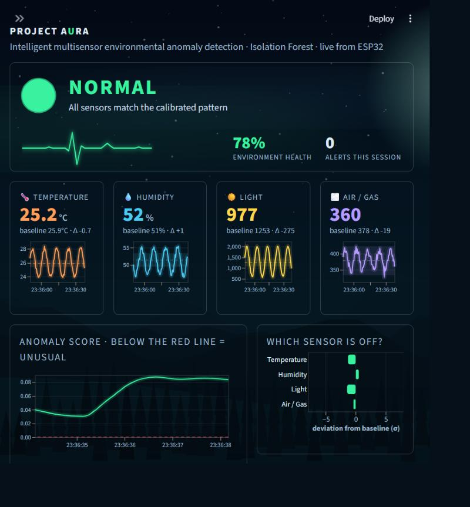

# Project AURA: Environmental Anomaly Detection

**Intelligent multisensor environmental anomaly detection and monitoring using AI.**

An ESP32 reads temperature, humidity, light and air quality, streams them over USB to a Python app, and an unsupervised **Isolation Forest** learns what *normal* looks like for the room. Readings that deviate from that learned pattern raise an alert on a live dashboard and on a traffic-light module (green / yellow / red).



## Why not simple thresholds?

Fixed-threshold monitors check each sensor on its own. AURA analyses all sensors **together** against a baseline learned in the actual environment, so it can flag unusual combinations as well as single sensors that drift out of range. There is no pre-trained model: it fits on a few minutes of calibration data, which is unsupervised and needs no labels.

## How it works

```
DHT11 (temp, humidity) + LDR module (light) + MQ-135 (air quality)
        |
     ESP32  --- reads every 2 s, prints "temp,hum,light,gas*XX" ---
        |  USB serial, 115200 baud
  SerialReader thread --> AuraEngine (background thread)
                            - calibration + gas warm-up guard
                            - Isolation Forest scoring, 3-in-a-row debounce
                            - per-sensor deviation + event log
                            - sends '0' / '1' / '2' back every 2 s
        |                                   |
  Streamlit dashboard (display only)    ESP32 -> traffic light
                                        green = normal, yellow = calibrating / not monitored,
                                        red (+ optional buzzer) = anomaly
```

The engine runs in its own thread, so alerts keep working even when no browser tab is open. If the app stops talking for 10 s, the ESP32 falls back to yellow so a stale red alarm never sticks.

## Hardware

| Part | Notes |
|---|---|
| ESP32 DevKit (30/38 pin) | USB **data** cable required |
| DHT11 | temperature and humidity (a DHT22 also works: change `DHTTYPE`) |
| MH-series LDR module (VCC, GND, DO, AO) | light, relative reading |
| MQ-135 module (VCC, GND, DO, AO) | air quality / smoke, relative reading |
| Traffic-light LED module (GND, R, Y, G) | built-in resistors |
| Small active buzzer (optional) | via NPN transistor, or a 3-pin module |
| 2 x 1.5 kΩ resistors | voltage divider for the MQ analog output |

| Part | ESP32 pin |
|---|---|
| DHT11 DATA | GPIO4 (VCC 3V3, GND) |
| LDR module AO | GPIO34 (VCC **3V3**, GND, DO unused) |
| MQ-135 AO | GPIO35 **through a 1.5 kΩ + 1.5 kΩ divider** (VCC **VIN 5 V**, GND, DO unused) |
| Traffic light R / Y / G | GPIO27 / GPIO25 / GPIO26 (GND to GND) |
| Buzzer (optional) | GPIO33 |

> **Important:** the MQ heater needs 5 V and its AO can reach 5 V, but ESP32 pins are 3.3 V only. Always put AO through the divider. Keep the 5 V and 3V3 breadboard rails separate. Full step-by-step wiring and troubleshooting: [docs/Wiring_Guide.md](docs/Wiring_Guide.md).

## The model

- **Isolation Forest** (scikit-learn, 200 trees), fitted on the calibration readings.
- **Noise floors:** the DHT11 barely changes, and Isolation Forest cannot split on a feature that was flat during calibration. Training therefore uses the calibration data plus jittered copies with a per-sensor tolerance (absolute floor or a percentage of the baseline). This also stops normal drift in light and gas from alarming.
- **Threshold:** a quantile of the forest's scores over the training cloud (sensitivity 0.20 by default, adjustable in the sidebar). Tuned against real recordings: no false alarms on quiet data, and all seven synthetic test anomalies detected (temperature, humidity, light covered, light halved, two gas levels, and a combination).
- **Debounce:** an alert needs 3 anomalous readings in a row (about 6 s).
- **Explainability:** each alert reports the sensors that deviate most from the baseline, in tolerance units (for example "Gas +4.1σ").

## Dashboard

Dark "monitor" theme over a generated forest landscape, an animated ECG strip and status badge, glowing per-sensor traces with the calibrated baseline band (red dots mark anomalous readings), an anomaly-score trace, "which sensor is off" deviation bars, an environment-health gauge, an event log with likely causes, an alert counter, a chart-window selector, a sensitivity slider, and a CSV download of every reading.

## Quick start

**1. Firmware** (PlatformIO, VS Code or CLI):

```powershell
cd aura-firmware
pio run -t upload --upload-port COM12      # use your ESP32's port
```

**2. App** (Python 3.10+):

```powershell
cd aura-app
python -m venv venv
venv\Scripts\pip install -r requirements.txt
venv\Scripts\streamlit run app.py          # or double-click run_dashboard.bat
```

Close any serial monitor first (one program per COM port).

**3. Use it:** pick the ESP32's COM port in the sidebar, wait for the 120 s gas warm-up, keep the room normal, and press **Start calibration** (4 min, or vary light and temperature through their usual range). **Load last** reuses the previous calibration.

No hardware? Open `http://localhost:8501/?source=sim` to use the built-in simulator, where you can also inject anomalies.

## Tests

```powershell
cd aura-app
venv\Scripts\python -m pytest -q tests     # 15 tests: model, engine, serial parsing
```

The tests cover per-sensor detection (even when a sensor was flat during calibration), ambient-drift tolerance, debounce, event log and cause reporting, calibration failure handling, warm-up blocking, state heartbeat, and the serial checksum parser.

## Project layout

```
aura-firmware/        PlatformIO project (src/main.cpp)
aura-app/
  serial_reader.py    serial thread, checksum parsing, auto-reconnect
  model.py            Isolation Forest wrapper
  engine.py           calibration, scoring, debounce, alerts, events
  simulator.py        fake ESP32 for testing without hardware
  app.py              Streamlit dashboard
  tests/              pytest suite
docs/                 wiring guide, spec review and original plan
```

## Status

| Area | State |
|---|---|
| Sensors, firmware, serial link (checksummed), model, dashboard | Working, tested on hardware |
| Light-cover alert with red traffic-light LED | Confirmed on hardware |
| Breath and smoke alerts (MQ-135) | Detected and logged on hardware |
| Buzzer | Optional; firmware drives it, not tested in the AURA build |
| USB unplug / replug recovery | Implemented, not yet tested on hardware |

## Limitations

- A prototype for monitoring and anomaly detection, **not** a certified safety or pollution instrument. "Anomaly" means unusual compared with the calibration, not dangerous.
- Light and gas values are relative (raw ADC), not lux or ppm.
- MQ sensors drift for minutes while warming up and recover slowly after smoke or breath. Calibrate after warm-up and recalibrate when the room changes substantially.
- Slow, legitimate changes outside the calibrated range will eventually raise alerts.

## Future scope

More sensors (noise, pressure, particulates), wireless transport (BLE or Wi-Fi) and a mobile app, SMS or push notifications, cloud history, and optional supervised classification of known conditions.

## Docs

- [Wiring guide](docs/Wiring_Guide.md)
- [Spec review and original plan](docs/Review_and_Software_Plan.md)
